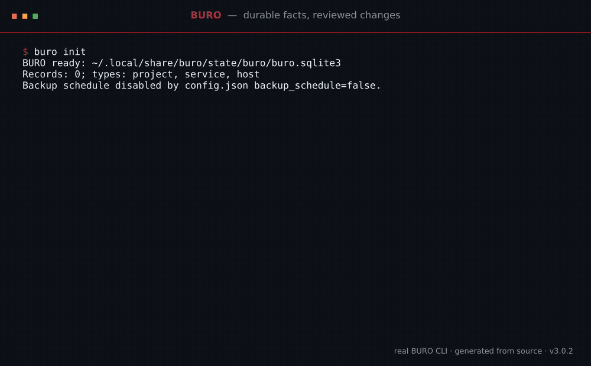

<h1 align="center">BURO</h1>
<p align="center"><strong>Typed memory for the things you work on.</strong></p>
<p align="center"><a href="README.md"><strong>English</strong></a> · <a href="README.ru.md">Русский</a></p>

BURO is a CLI and SQLite memory for AI agents. It keeps facts, rules, and decisions
about specific projects, services, devices, books, and other work objects between
sessions. The agent opens the relevant typed record when your task needs it.

A useful record can be small:

```yaml
id: my-site
name: My website
kind: project
important:
  - Ask me before publishing.
```

Only `id`, `name`, and `kind` are required by the bundled types. BURO checks
formats, references, and conflicting edits. You and your agent check the facts.

## Install and connect

Requires **Node.js 24.14 or newer**.

```sh
npm install -g https://github.com/Krablante/buro/releases/download/v3.0.1/buro-3.0.1.tgz
buro init
buro connect opencodez
```

Replace `opencodez` with `opencode`, `codex`, or `claude` as needed. The package
includes the skill and connections: no separate plugin package is needed.
OpenCode/OpenCodez must restart. In local Codex, review and trust the new hook
in `/hooks`, then start a new session. In Claude Code, start a new session.

**connect installs the skill and a session context connection. It does not edit
your System prompt.** If wanted, add [the supplied prompt](integrations/system-prompt.md)
yourself. An explicit `buro connect file --path /path/to/AGENTS.md` adds instructions
to that file, without installing an automatic context connection.

At session start, the connection runs `buro current` once and supplies the current
device's record, when present, plus a bounded list of associated objects. The agent
chooses which full records to open from your task. Connection failures are reported
to the agent and do not prevent chatting. BURO runs no model and does not scan chats
or files in the background.

## Read and remember

```sh
buro my-site
buro search website
buro list project
buro current
buro help
```

Exact IDs win. Ambiguous names return candidate IDs. Use `buro get <id>` for an
ID that matches a command. Search covers IDs, names, and aliases; list and search
accept `--limit` and `--offset`. Help shows commands, the memory target, and the
actual active types with nested fields and their guides.

Every change gets its own temporary YAML file:

```sh
buro draft new my-site project     # or draft pull / draft delete
# Edit the file printed by the command; retain its __buro metadata.
buro draft diff /tmp/buro-draft-EXAMPLE/change.yaml
buro draft push /tmp/buro-draft-EXAMPLE/change.yaml
```

Use the actual printed path in the last two commands. A failed push keeps the
draft. Separate sessions can edit different records. Changes to the same record
or its type make older drafts stale. By default the skill tells the agent to save
useful confirmed changes at the end of work; you can change that policy.



## Types belong to your memory

New memories include `project`, `service`, and `host`. Their content fields are
optional. You may use only your own types; no host record or folder layout is
required. A project is a product or independent undertaking; a service is a
technical component of the working environment.

```sh
buro types new book
buro types new my-project --from project
buro types edit book
buro types delete book
```

These commands print drafts too. Review and push them with the same commands.
Custom definitions are stored in SQLite and immediately available after push.
There are no external type paths to maintain and no inheritance between copies.
See [types, fields, and reviewed changes](docs/model.md).

## Local or shared

Without `api_url`, BURO uses local SQLite. On a trusted private network, run
`buro serve --host 0.0.0.0` on the database device and set its URL in the other
devices' `~/.config/buro/config.json`:

```json
{"api_url": "http://registry:8765", "current_context": "laptop"}
```

Clients keep no database copies and never fall back to a different memory.
The server binds to loopback by default. It has no authentication or TLS; allow
trusted clients through a private network, VPN, tunnel, or protected HTTPS proxy.

Before every mutation BURO requires a successful snapshot. Local `init` installs
an OS backup schedule: eight snapshots every three hours, eight daily snapshots,
and twenty before mutations are retained independently. Scheduler failures are
reported with a manual alternative. Keys and tokens may be stored, but BURO does
not encrypt its database, exports, or backups.

| Topic | English | Русский |
| --- | --- | --- |
| Types, record edits, v2 migration | [Model](docs/model.md) | [Модель](docs/model.ru.md) |
| Connections and manual prompt setup | [Agents](docs/agents.md) | [Агенты](docs/agents.ru.md) |
| Config, backup, recovery, deployment | [Operations](docs/operations.md) | [Эксплуатация](docs/operations.ru.md) |
| Architecture, API, development, releases | [Development](docs/development.md) | [Разработка](docs/development.ru.md) |

Licensed under [MIT](LICENSE).
