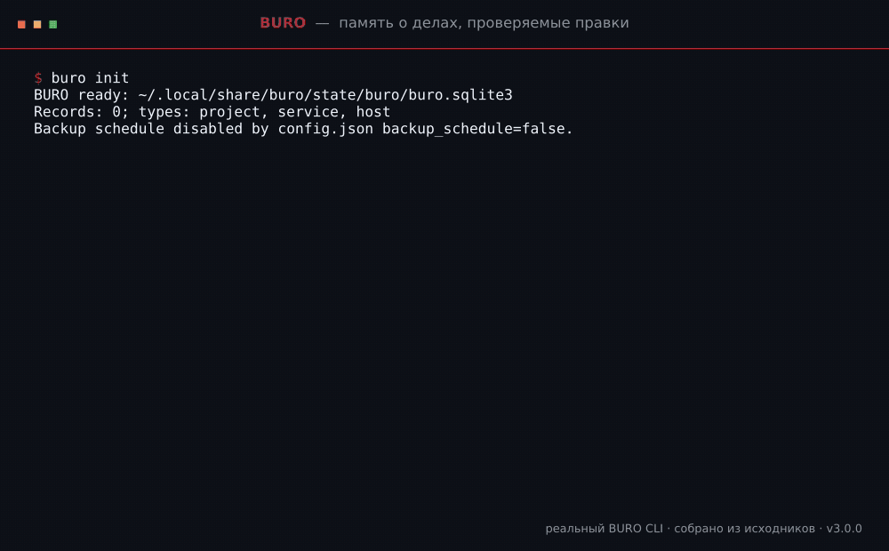

<h1 align="center">BURO</h1>
<p align="center"><strong>Типизированная память о том, с чем вы работаете.</strong></p>
<p align="center"><a href="README.md">English</a> · <a href="README.ru.md"><strong>Русский</strong></a></p>

BURO сохраняет между сессиями агента сведения, правила и решения о конкретных
проектах, сервисах, устройствах, книгах и других рабочих объектах. Агент открывает
нужную запись вместо загрузки растущего файла памяти или сборки контекста из RAG.

Полезная запись может быть небольшой:

```yaml
id: my-site
name: Мой сайт
kind: project
important:
  - Согласовать со мной публикацию.
```

У готовых типов обязательны только `id`, `name` и `kind`. BURO проверяет формат,
ссылки и конфликты правок. Достоверность проверяют пользователь и агент.

## Установка и подключение

Нужен **Node.js 24.14 или новее**.

```sh
npm install -g https://github.com/Krablante/buro/releases/download/v3.0.0/buro-3.0.0.tgz
buro init
buro connect opencodez
```

Вместо `opencodez` можно указать `opencode`, `codex` или `claude`. Skill и
подключения входят в пакет; отдельный пакет плагина не нужен. OpenCode/OpenCodez
нужно перезапустить. В локальном Codex проверьте и разрешите новый hook через
`/hooks`, затем начните новую сессию. В Claude Code начните новую сессию.

**connect устанавливает skill и загрузку контекста сессии. Системный промпт он
не редактирует.** Если нужна инструкция в промпте, добавьте
[готовый блок](integrations/system-prompt.md) сами. Явная команда
`buro connect file --path /path/to/AGENTS.md` добавляет инструкцию в указанный
файл, но не устанавливает автоматическую загрузку контекста.

В начале сессии подключение один раз запускает `buro current`: передаёт запись
устройства, если она есть, и ограниченный список связанных объектов. Нужные полные
записи агент выбирает по вашей задаче. Ошибка подключения видна агенту и не мешает
начать разговор. BURO не запускает нейросеть и не читает чаты или файлы в фоне.

## Чтение и сохранение

```sh
buro my-site
buro search сайт
buro list project
buro current
buro help
```

Точный ID имеет приоритет. При неоднозначном имени видны ID кандидатов. Для ID,
совпавшего с командой, есть `buro get <id>`. Поиск охватывает ID, имена и псевдонимы;
list и search принимают `--limit` и `--offset`. Help показывает команды, подключённую
память и её действующие типы с вложенными полями и пояснениями.

Каждая правка получает собственный временный YAML-файл:

```sh
buro draft new my-site project     # либо draft pull / draft delete
# Отредактируйте напечатанный файл, сохранив метаданные __buro.
buro draft diff /tmp/buro-draft-EXAMPLE/change.yaml
buro draft push /tmp/buro-draft-EXAMPLE/change.yaml
```

В двух последних командах нужен настоящий путь из вывода. Неудачный push оставляет
черновик. Разные сессии могут править разные записи. Изменение той же записи или её
типа делает прежний черновик устаревшим. По умолчанию skill поручает агенту сохранять
полезные подтверждённые изменения в конце работы; это правило можно изменить.



## Типы хранятся вместе с памятью

Новая память получает `project`, `service` и `host`. Все их содержательные поля
необязательны. Можно вести только записи своих типов; запись устройства и общая
структура папок не требуются. Проект — продукт или самостоятельное дело;
сервис — технический компонент рабочей среды.

```sh
buro types new book
buro types new my-project --from project
buro types edit book
buro types delete book
```

Эти команды тоже создают черновики. Проверяйте и применяйте их теми же diff и push.
Свои определения хранятся в SQLite и доступны сразу после push. Пути к внешним
определениям и наследование между копиями отсутствуют. Подробности —
[в описании типов, полей и правок](docs/model.ru.md).

## Местная или общая память

Без `api_url` BURO работает с местной SQLite. Для общей памяти запустите
`buro serve` на устройстве с базой и укажите его URL в настройках остальных:

```json
{"api_url": "http://registry:8765", "current_context": "laptop"}
```

Клиенты не хранят копий базы и не переключаются на другую память при ошибке связи.
По умолчанию сервер слушает только loopback. В нём нет аутентификации и TLS;
допускайте доверенных клиентов через частную сеть, VPN, туннель или HTTPS-прокси
с ограничением доступа.

Перед каждой правкой BURO требует успешный снимок. Местный `init` устанавливает
расписание ОС: отдельно хранятся восемь копий каждые три часа, восемь суточных
и двадцать перед правками. При сбое планировщика видны ошибка и ручная альтернатива.
Ключи и токены хранить можно, но BURO не шифрует базу, экспорты и резервные копии.

| Тема | English | Русский |
| --- | --- | --- |
| Типы, правки записей, переход с v2 | [Model](docs/model.md) | [Модель](docs/model.ru.md) |
| Подключения и ручная настройка промпта | [Agents](docs/agents.md) | [Агенты](docs/agents.ru.md) |
| Настройки, копии, восстановление, установка | [Operations](docs/operations.md) | [Эксплуатация](docs/operations.ru.md) |
| Архитектура, API, разработка, выпуски | [Development](docs/development.md) | [Разработка](docs/development.ru.md) |

Лицензия [MIT](LICENSE).
